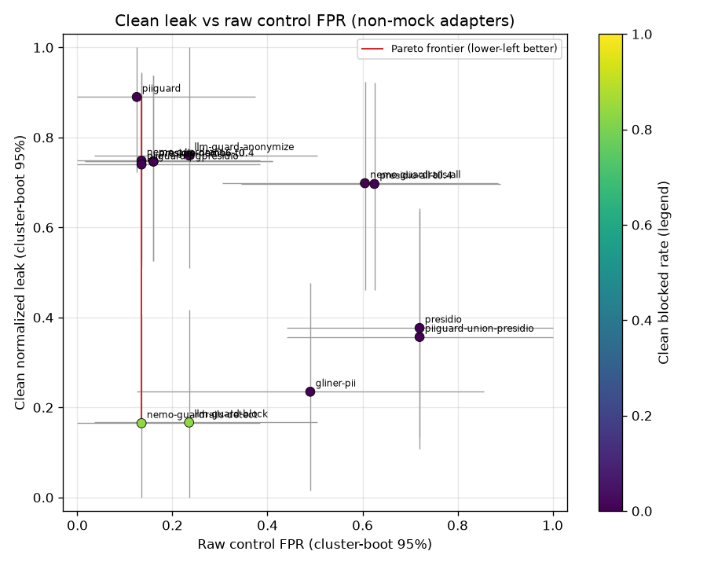
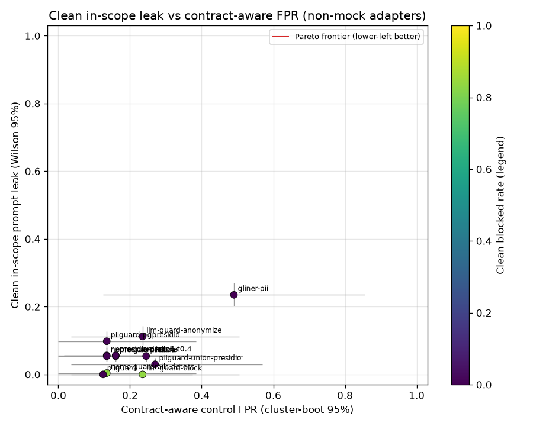
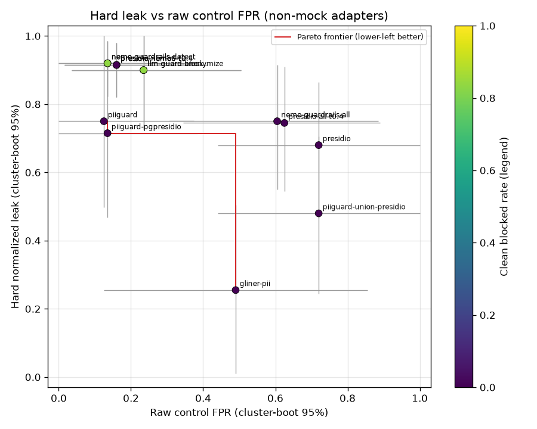
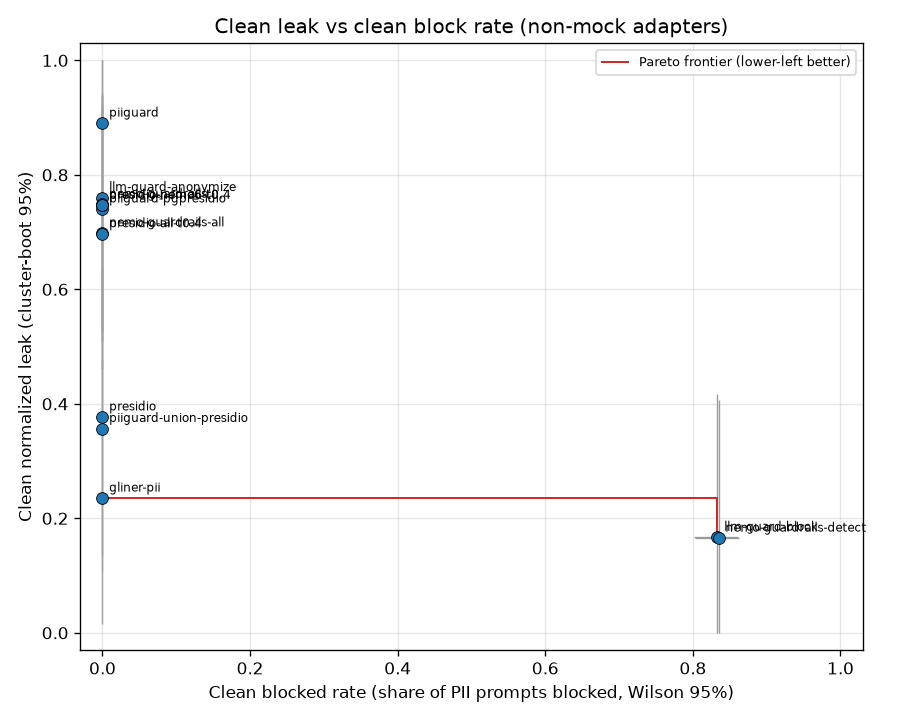

# results

Exploratory runs of the scoring pipeline (scorer v2) on two inputs: the committed Gretel sample and the frozen
generated set `pgb-v1.0`. **These are not official benchmark results and not a product ranking.** Read the caveats
before quoting a number. Every number below is copied from the result files in this folder.

Disclosure: piiguard is written by this benchmark's author. No adapter was changed after seeing these numbers, and
no configuration was tuned: every row uses library defaults or a fixed, documented setting.

## Files

| File | Content |
| --- | --- |
| `gretel-en-v1.json`, `gretel-en-v1.leaderboard.txt`, `gretel-en-v1/per_prompt.jsonl` | Gretel sample, 500 prompts |
| `pgb-v1.0-{clean,control,hard}.json`, `.leaderboard.txt`, `pgb-v1.0-{layer}/per_prompt.jsonl` | Frozen set, one run per layer |
| `figures/*.png`, `figures/README.md` | Leak vs FPR / block-rate Pareto figures (`scripts/make_figures.py`) |

The JSON files hold all numbers (incl. McNemar/Holm, rank intervals, per-adapter config, hardware, versions). The
`.leaderboard.txt` files are the exact CLI output. `per_prompt.jsonl` has one row per adapter x prompt (exact /
normalized / partial flags, blocked, raw and contract-aware FP, `detected_types`, layer, template, latency, returned text).

## Commands

From the repo root. `PIIGUARD_GUARD_DIR` points at a piiguard checkout's `guard/` folder. `PGB_LLM_GUARD_PYTHON`
points at the interpreter of the separate LLM Guard venv (see open items).

```bash
export PIIGUARD_GUARD_DIR=/path/to/piiguard/guard
export PGB_LLM_GUARD_PYTHON=/path/to/llmguard-venv/bin/python
ALL=presidio,presidio-all-t0.4,presidio-nemo6-t0,presidio-nemo6-t0.4,nemo-guardrails,nemo-guardrails-all,nemo-guardrails-detect,piiguard,piiguard-pgpresidio,piiguard-union-presidio,gliner-pii,llm-guard-anonymize,llm-guard-block,mock-leaky,mock-redact

python -m pii_guardbench.cli --dataset gretel-en-v1 --adapters $ALL \
  --out results/gretel-en-v1.json --out-dir results/gretel-en-v1 > results/gretel-en-v1.leaderboard.txt

for L in clean control hard; do
  python -m pii_guardbench.cli --prompts data/official/pgb-v1.0/prompts.jsonl --layer $L --adapters $ALL \
    --out results/pgb-v1.0-$L.json --out-dir results/pgb-v1.0-$L > results/pgb-v1.0-$L.leaderboard.txt
done
python scripts/make_figures.py   # needs: pip install -e ".[figures]"
```

## Environment

8 vCPU Intel Xeon (cloud VM), 15.6 GB RAM, no GPU, Linux 6.12, Python 3.13.5. Latency is wall-clock per prompt on
CPU, measured sequentially after a warm-up call, so it is only comparable across rows of one run. Versions:
presidio-analyzer/anonymizer 2.2.366, spaCy 3.8.18 with `en_core_web_lg` 3.8.0, nemoguardrails 0.25.0, piiguard
0.1.0 with `guard/rules.yaml` `version: 23` (rules SHA-256 `4369f4e8...a4c0`), gliner 0.2.30, torch 2.15.0+cpu,
transformers 5.22.2. LLM Guard venv: llm-guard 0.3.16, presidio-analyzer 2.2.358, transformers 4.51.3, spaCy 3.8.18
with `en_core_web_sm` 3.8.0.

Scorer v2: normalized + exact leak, partial last-4, span leak, blocked rate and residual exposure given block,
raw and contract-aware FPR, control_blocked_rate, cluster bootstrap (reported) + Wilson (secondary), paired McNemar with Holm, bootstrap rank intervals (2,000 iterations, seed 0).

## Adapter configurations (defaults, not tuned)

| Row | What ran | Blocks? |
| --- | --- | --- |
| `presidio` | `AnalyzerEngine()` defaults (`en_core_web_lg`, all 20 default recognizers, no entity filter, threshold 0), `AnonymizerEngine()` default replace-with-`<ENTITY>` | no |
| `presidio-all-t0.4` | Same, threshold 0.4 | no |
| `presidio-nemo6-t0` | Presidio restricted to NeMo's example 6 entities (`PERSON, EMAIL_ADDRESS, PHONE_NUMBER, CREDIT_CARD, US_SSN, LOCATION`), threshold 0 | no |
| `presidio-nemo6-t0.4` | Same 6 entities, threshold 0.4 | no |
| `nemo-guardrails` | NeMo's Presidio-backed `mask_sensitive_data` action, NeMo example 6 entities, mask. Threshold is fixed at 0.4 by nemoguardrails 0.25.0 (the action ignores `score_threshold`), so NeMo mask at threshold 0 is impossible; `presidio-nemo6-t0` is the stand-in | no |
| `nemo-guardrails-all` | Same mask action with all 20 Presidio entities, effective threshold 0.4 | no |
| `nemo-guardrails-detect` | NeMo's real blocking input rail `detect_sensitive_data`, 6 entities, threshold 0.4. A blocked prompt returns NeMo's default refusal text | yes |
| `piiguard` | `Guard.from_dir(guard/)`: committed learned regex rules only, no classifier, no LLM | no |
| `piiguard-pgpresidio` | Rules plus piiguard's own `PresidioDetector` (15 entities, threshold 0.5). Not plain Presidio. Renamed from `piiguard-presidio`; the old name is kept as an alias | no |
| `piiguard-union-presidio` | True union of the rules and the same `AnalyzerEngine()` defaults as `presidio` (threshold 0), both on the original text, merged spans replaced with `<PII>` | no |
| `gliner-pii` | GLiNER `urchade/gliner_multi_pii-v1`, 12 labels (one per benchmark category), threshold 0.5, 256-token chunks (32 overlap), replace with `<LABEL>` | no |
| `llm-guard-anonymize` | `Anonymize(Vault())` library defaults, returns sanitized text | no |
| `llm-guard-block` | Same scan; the prompt is blocked when the scanner returns `is_valid=False` | yes |
| `mock-leaky` | Pass-through reference (leak must be 100%) | no |
| `mock-redact` | Demo regexes for card/SSN/API key plus 6+ digit runs. Reference only | no |

NeMo's GLiNER PII rails need a NIM server and were not run. The remote piiguard LLM classifier needs an API key and
was not run.

## Iteration 1 vs this rerun (Gretel)

Iteration-1 prompt leak counts were presidio 209/500, nemo-guardrails 336/500, piiguard 466/500, piiguard-presidio
342/500, mock-redact 466/500, mock-leaky 500/500. The rerun gives exactly the same normalized leak for all six
(`piiguard-presidio` now appears as `piiguard-pgpresidio`), and the same normalized span counts (244, 473, 958,
476, 995, 1324 of 1324). Only latency differs.

### Scorer v1 to v2 on the same outputs

v1 = commit `3405368` (whole-token exact match, `blocked=True` never a leak). v2 = this scorer. Same sample, same
adapter configs.

| Row | v1 prompt leak | v2 exact leak | v2 normalized leak | v1 leaked spans | v2 leaked spans (normalized) | v2 blocked | v2 partial (last-4, card/SSN prompts) |
| --- | --- | --- | --- | --- | --- | --- | --- |
| mock-leaky | 500/500 (100.0%) | 500/500 (100.0%) | 500/500 (100.0%) | 1324/1324 | 1324/1324 | 0/500 (0.0%) | 0/190 (0.0%) |
| mock-redact | 466/500 (93.2%) | 466/500 (93.2%) | 466/500 (93.2%) | 995/1324 | 995/1324 | 0/500 (0.0%) | 0/190 (0.0%) |
| presidio | 209/500 (41.8%) | 209/500 (41.8%) | 209/500 (41.8%) | 244/1324 | 244/1324 | 0/500 (0.0%) | 0/190 (0.0%) |
| nemo-guardrails | 336/500 (67.2%) | 336/500 (67.2%) | 336/500 (67.2%) | 472/1324 | 473/1324 | 0/500 (0.0%) | 0/190 (0.0%) |
| piiguard | 466/500 (93.2%) | 466/500 (93.2%) | 466/500 (93.2%) | 957/1324 | 958/1324 | 0/500 (0.0%) | 0/190 (0.0%) |
| piiguard-presidio (now piiguard-pgpresidio) | 342/500 (68.4%) | 342/500 (68.4%) | 342/500 (68.4%) | 475/1324 | 476/1324 | 0/500 (0.0%) | 0/190 (0.0%) |

Prompt-level numbers are unchanged: none of these guards reformats values (Presidio and NeMo replace whole
entities with `<ENTITY>`, piiguard masks whole values) and none sets `blocked`, so normalized matching, partial
exposure and residual-exposure-given-block have nothing extra to catch on this sample. The +1 span for
nemo-guardrails, piiguard and piiguard-presidio is one Gretel record whose text also contains the card digits as a
price (`$367,722.81189748`); after the card itself is masked, normalized digit matching still finds the digits in
the price. That is a genuine digit-level exposure but also a matcher edge case (commas and dots are treated as digit
separators). It moves only the span-level count.

## Gretel ablation (`gretel-en-v1`, 500 prompts, 0 controls)

| Row | Exact leak | Norm leak | Wilson 95% | Cluster-boot 95% | Span leak | Span boot 95% | Blocked | Resid\|block | Latency mean ms |
| --- | --- | --- | --- | --- | --- | --- | --- | --- | --- |
| presidio | 0.418 (209/500) | 0.418 (209/500) | [0.376, 0.462] | [0.374, 0.460] | 0.184 (244/1324) | [0.163, 0.206] | 0.000 (0/500) | n/a (0/0) | 8.55 |
| presidio-all-t0.4 | 0.626 (313/500) | 0.628 (314/500) | [0.585, 0.669] | [0.584, 0.672] | 0.319 (423/1324) | [0.294, 0.347] | 0.000 (0/500) | n/a (0/0) | 7.85 |
| presidio-nemo6-t0 | 0.658 (329/500) | 0.660 (330/500) | [0.617, 0.700] | [0.616, 0.702] | 0.346 (458/1324) | [0.319, 0.374] | 0.000 (0/500) | n/a (0/0) | 7.25 |
| presidio-nemo6-t0.4 | 0.660 (330/500) | 0.662 (331/500) | [0.619, 0.702] | [0.620, 0.704] | 0.347 (459/1324) | [0.320, 0.375] | 0.000 (0/500) | n/a (0/0) | 7.31 |
| nemo-guardrails | 0.672 (336/500) | 0.672 (336/500) | [0.630, 0.712] | [0.632, 0.714] | 0.357 (473/1324) | [0.330, 0.385] | 0.000 (0/500) | n/a (0/0) | 9.16 |
| nemo-guardrails-all | 0.636 (318/500) | 0.636 (318/500) | [0.593, 0.677] | [0.592, 0.680] | 0.329 (436/1324) | [0.303, 0.357] | 0.000 (0/500) | n/a (0/0) | 8.63 |
| nemo-guardrails-detect | 0.138 (69/500) | 0.138 (69/500) | [0.111, 0.171] | [0.108, 0.170] | 0.078 (103/1324) | [0.059, 0.100] | 0.862 (431/500) | 0.000 (0/431) | 7.89 |
| piiguard | 0.932 (466/500) | 0.932 (466/500) | [0.906, 0.951] | [0.910, 0.954] | 0.724 (958/1324) | [0.699, 0.748] | 0.000 (0/500) | n/a (0/0) | 0.27 |
| piiguard-pgpresidio | 0.684 (342/500) | 0.684 (342/500) | [0.642, 0.723] | [0.642, 0.724] | 0.360 (476/1324) | [0.333, 0.386] | 0.000 (0/500) | n/a (0/0) | 9.41 |
| piiguard-union-presidio | 0.402 (201/500) | 0.402 (201/500) | [0.360, 0.446] | [0.358, 0.444] | 0.177 (235/1324) | [0.156, 0.199] | 0.000 (0/500) | n/a (0/0) | 9.04 |
| gliner-pii | 0.234 (117/500) | 0.236 (118/500) | [0.201, 0.275] | [0.198, 0.272] | 0.108 (143/1324) | [0.089, 0.128] | 0.000 (0/500) | n/a (0/0) | 108.65 |
| llm-guard-anonymize | 0.800 (400/500) | 0.800 (400/500) | [0.763, 0.833] | [0.764, 0.834] | 0.441 (584/1324) | [0.415, 0.467] | 0.000 (0/500) | n/a (0/0) | 73.29 |
| llm-guard-block | 0.142 (71/500) | 0.142 (71/500) | [0.114, 0.175] | [0.112, 0.174] | 0.079 (105/1324) | [0.060, 0.101] | 0.858 (429/500) | 0.000 (0/429) | 74.11 |
| mock-leaky | 1.000 (500/500) | 1.000 (500/500) | [0.992, 1.000] | [1.000, 1.000] | 1.000 (1324/1324) | [1.000, 1.000] | 0.000 (0/500) | n/a (0/0) | 0.00 |
| mock-redact | 0.932 (466/500) | 0.932 (466/500) | [0.906, 0.951] | [0.910, 0.952] | 0.752 (995/1324) | [0.728, 0.776] | 0.000 (0/500) | n/a (0/0) | 0.02 |

Partial (last-4) is 0.000 (0/190) for every row. FPR is n/a (no controls).

### In-scope entity contract (Gretel)

Normalized leak restricted to the categories each system is configured for. Shared scope = `credit_card, email,
phone, ssn` (intersection of the declared contracts of non-mock adapters).

| Row | Configured categories | In-scope prompt leak | In-scope span leak | Shared-scope prompt leak | Shared-scope span leak |
| --- | --- | --- | --- | --- | --- |
| presidio | account_number,address,credit_card,email,name,phone,ssn | 0.238 (103/432) | 0.113 (115/1022) | 0.204 (65/319) | 0.140 (69/492) |
| presidio-all-t0.4 | account_number,address,credit_card,email,name,phone,ssn | 0.317 (137/432) | 0.157 (160/1022) | 0.266 (85/319) | 0.187 (92/492) |
| presidio-nemo6-t0 | address,credit_card,email,name,phone,ssn | 0.311 (132/425) | 0.154 (151/983) | 0.301 (96/319) | 0.211 (104/492) |
| presidio-nemo6-t0.4 | address,credit_card,email,name,phone,ssn | 0.311 (132/425) | 0.154 (151/983) | 0.301 (96/319) | 0.211 (104/492) |
| nemo-guardrails | address,credit_card,email,name,phone,ssn | 0.329 (140/425) | 0.166 (163/983) | 0.301 (96/319) | 0.211 (104/492) |
| nemo-guardrails-all | account_number,address,credit_card,email,name,phone,ssn | 0.333 (144/432) | 0.167 (171/1022) | 0.266 (85/319) | 0.187 (92/492) |
| nemo-guardrails-detect | address,credit_card,email,name,phone,ssn | 0.059 (25/425) | 0.027 (27/983) | 0.056 (18/319) | 0.037 (18/492) |
| piiguard | credit_card,email,phone,ssn | 0.389 (124/319) | 0.291 (143/492) | 0.389 (124/319) | 0.291 (143/492) |
| piiguard-pgpresidio | account_number,address,credit_card,email,name,phone,ssn | 0.373 (161/432) | 0.193 (197/1022) | 0.320 (102/319) | 0.236 (116/492) |
| piiguard-union-presidio | account_number,address,credit_card,email,name,phone,ssn | 0.220 (95/432) | 0.104 (106/1022) | 0.179 (57/319) | 0.122 (60/492) |
| gliner-pii | account_number,address,api_key,credit_card,diagnosis,email,mrn,name,password,phone,ssn,token | 0.236 (118/500) | 0.108 (143/1324) | 0.116 (37/319) | 0.085 (42/492) |
| llm-guard-anonymize | account_number,credit_card,email,name,phone,ssn | 0.280 (116/414) | 0.154 (132/856) | 0.204 (65/319) | 0.140 (69/492) |
| llm-guard-block | account_number,credit_card,email,name,phone,ssn | 0.058 (24/414) | 0.030 (26/856) | 0.041 (13/319) | 0.026 (13/492) |

### Matched comparisons (paired McNemar on normalized leak, Gretel)

| Pair (A vs B) | only A leaks | only B leaks | p exact | p Holm | rate(A)-rate(B) [cluster-boot 95%] |
| --- | --- | --- | --- | --- | --- |
| presidio-nemo6-t0.4 vs nemo-guardrails | 0 | 5 | 0.0625 | 0.4375 | -0.010 [-0.020, -0.002] |
| presidio-all-t0.4 vs nemo-guardrails-all | 0 | 4 | 0.125 | 0.5 | -0.008 [-0.016, -0.002] |
| presidio vs piiguard-union-presidio | 8 | 0 | 0.007812 | 0.07917 | +0.016 [+0.006, +0.028] |
| presidio vs piiguard-pgpresidio | 4 | 137 | 1.165e-35 | 4.662e-34 | -0.266 [-0.308, -0.226] |

At matched entity list and threshold, NeMo's mask action and plain Presidio differ by a handful of prompts and the
difference is not significant after Holm. Adding piiguard's rules to default Presidio (the union) removes 8 more
leaking prompts (not significant after Holm). piiguard-pgpresidio is a different Presidio configuration and leaks
much more than `presidio`.

### Gretel caveats

- Data: `data/external/gretel-en-v1/sample.jsonl`, 500 records (seed 20261126) from the test split of
  `gretelai/gretel-pii-masking-en-v1` (Apache-2.0). Text is **synthetic**, labels are generator labels (no human
  review), and there are **0 no-PII controls**, so FPR is `n/a` for every row.
- **Unmapped labels were dropped.** 9,542 of 21,378 entities (44.6%) had labels with no benchmark category (dates
  of birth, IP addresses, customer/employee IDs, license plates and so on) and were dropped; 578 of 5,000 records
  were dropped because they had no mapped entity. Unmapped values stay in the text and are not scored, which mostly
  flatters guards that do not detect them.
- **No template or cluster ids.** The cluster bootstrap falls back to one cluster per record (500 clusters), so
  Wilson and the bootstrap both treat prompts as independent.
- The sample is stratified with a per-category floor, so rare categories are over-represented. Do not read the
  overall rate as a population estimate for Gretel or for real traffic.
- **Normalized match is still lenient on partial redaction of multi-token values.** If a guard masks part of an
  address or name, the remaining fragment is not counted. Leak rates are lower bounds on residual exposure.
- **The sample excludes provider-token-shaped keys** (29 records, to keep secret scanners quiet), so API-key results
  understate how guards handle well-known key formats; `api_key` has only 24 records.
- **Category fit drives the ranking.** piiguard's rules target structured identifiers (SSN, card, phone, email and
  obfuscated variants) and leave names, addresses, MRNs, API keys and passwords untouched. The in-scope table above
  is the fairer view.
- **Label noise exists** (for example a UK NI-style number labeled `ssn`), which can penalize a guard for declining
  to treat it as a US SSN.

## Frozen set `pgb-v1.0`

`data/official/pgb-v1.0/prompts.jsonl`, SHA-256 `d489a2953aad4484bd4f6efb7812ebf88b81d68372820a7eea829fdb54e2b447`,
seed 2026, n=1000 (600 clean / 200 control / 200 hard), split `public`, generator `pgb-gen-v2`. Regenerate with
`python -m generators.generate_prompts --n 1000 --seed 2026`.

Generated data clusters by `template_id`. The clean and hard runs have **12 PII clusters** each and the control run
has **8 control clusters** (headers of the `.leaderboard.txt` files). **The reported intervals are cluster-bootstrap
95% CIs** (2,000 iterations, seed 0); Wilson intervals treat prompts as independent and are kept only as secondary
columns. With 8 to 12 templates per layer the cluster CIs are very wide: this set is a diagnostic fixture, not a
large held-out corpus, and **close calls below are not established rankings**.

Definitions used below: `blocked_rate` = share of PII prompts the guard blocked; `control_blocked_rate` = share of
no-PII controls the guard blocked. A control is a **raw false positive** if it was blocked or if any token was
deleted or replaced (whitespace-split tokens, NFKC-normalized, edge punctuation stripped, compared by sequence diff;
pure insertions, whitespace changes, a trailing newline and edge punctuation changes are ignored;
`evaluator.is_false_positive`). A **contract-aware false positive** is a raw false positive that was blocked, or
that redacted at least one native entity type (per-prompt `detected_types`) mapping to a category in that adapter's
entity contract. Native types come from each adapter's own findings: Presidio anonymizer items, NeMo `<ENTITY>`
placeholders (NeMo's actions do not expose findings), piiguard finding types, union = `piiguard:<rule>` +
`presidio:<TYPE>`, GLiNER labels, LLM Guard `[REDACTED_<TYPE>_<n>]` placeholders (the worker returns only text).
Mocks have no contract: n/a.

### Leak vs cost figures

Generated by `scripts/make_figures.py`; see [`figures/README.md`](figures/README.md). Mocks excluded; error bars are
cluster-bootstrap CIs; the red step line is the Pareto frontier (lower-left is better).






### Who blocks

Only `nemo-guardrails-detect` and `llm-guard-block` ever block. Every other system only redacts by design. A blocked
prompt is scored on the refusal text. Blocking is a first-class cost: the low clean leak of these two rows is bought
by blocking most PII prompts, and on the hard layer they rarely block and leak like the mask rows.

| Row | Clean blocked | Clean resid\|block | Hard blocked | Hard resid\|block | control_blocked_rate |
| --- | --- | --- | --- | --- | --- |
| nemo-guardrails-detect | 0.835 (501/600) | 0.000 (0/501) | 0.080 (16/200) | 0.000 (0/16) | 0.135 (27/200) |
| llm-guard-block | 0.833 (500/600) | 0.000 (0/500) | 0.100 (20/200) | 0.000 (0/20) | 0.235 (47/200) |

### Clean layer (600 prompts)

| Row | Norm leak | Cluster 95% | Span leak | Cluster 95% | In-scope prompt leak | Blocked | Resid\|block | Wilson (iid, secondary): leak |
| --- | --- | --- | --- | --- | --- | --- | --- | --- |
| presidio | 0.377 (226/600) | [0.133, 0.643] | 0.206 (309/1500) | [0.065, 0.412] | 0.054 (27/500) | 0.000 (0/600) | n/a | [0.339, 0.416] |
| presidio-all-t0.4 | 0.697 (418/600) | [0.462, 0.922] | 0.417 (625/1500) | [0.254, 0.595] | 0.054 (27/500) | 0.000 (0/600) | n/a | [0.659, 0.732] |
| presidio-nemo6-t0 | 0.747 (448/600) | [0.525, 0.938] | 0.447 (671/1500) | [0.288, 0.628] | 0.056 (28/500) | 0.000 (0/600) | n/a | [0.710, 0.780] |
| presidio-nemo6-t0.4 | 0.747 (448/600) | [0.525, 0.938] | 0.447 (671/1500) | [0.288, 0.628] | 0.056 (28/500) | 0.000 (0/600) | n/a | [0.710, 0.780] |
| nemo-guardrails | 0.748 (449/600) | [0.527, 0.942] | 0.448 (672/1500) | [0.288, 0.628] | 0.056 (28/500) | 0.000 (0/600) | n/a | [0.712, 0.781] |
| nemo-guardrails-all | 0.698 (419/600) | [0.462, 0.923] | 0.417 (626/1500) | [0.254, 0.596] | 0.054 (27/500) | 0.000 (0/600) | n/a | [0.660, 0.734] |
| nemo-guardrails-detect | 0.165 (99/600) | [0.000, 0.407] | 0.132 (198/1500) | [0.000, 0.349] | 0.004 (2/500) | 0.835 (501/600) | 0.000 (0/501) | [0.137, 0.197] |
| piiguard | 0.890 (534/600) | [0.723, 1.000] | 0.589 (884/1500) | [0.426, 0.755] | 0.000 (0/450) | 0.000 (0/600) | n/a | [0.862, 0.913] |
| piiguard-pgpresidio | 0.740 (444/600) | [0.510, 0.945] | 0.441 (662/1500) | [0.278, 0.628] | 0.098 (49/500) | 0.000 (0/600) | n/a | [0.703, 0.773] |
| piiguard-union-presidio | 0.357 (214/600) | [0.108, 0.635] | 0.198 (297/1500) | [0.053, 0.408] | 0.030 (15/500) | 0.000 (0/600) | n/a | [0.319, 0.396] |
| gliner-pii | 0.235 (141/600) | [0.015, 0.477] | 0.119 (179/1500) | [0.007, 0.234] | 0.235 (141/600) | 0.000 (0/600) | n/a | [0.203, 0.271] |
| llm-guard-anonymize | 0.760 (456/600) | [0.510, 1.000] | 0.471 (706/1500) | [0.290, 0.655] | 0.112 (56/500) | 0.000 (0/600) | n/a | [0.724, 0.792] |
| llm-guard-block | 0.167 (100/600) | [0.000, 0.417] | 0.133 (200/1500) | [0.000, 0.357] | 0.000 (0/500) | 0.833 (500/600) | 0.000 (0/500) | [0.139, 0.199] |
| mock-leaky | 1.000 (600/600) | [1.000, 1.000] | 1.000 (1500/1500) | [1.000, 1.000] | n/a | 0.000 (0/600) | n/a | [0.994, 1.000] |
| mock-redact | 0.833 (500/600) | [0.583, 1.000] | 0.500 (750/1500) | [0.346, 0.643] | n/a | 0.000 (0/600) | n/a | [0.801, 0.861] |

### Hard layer (200 prompts, obfuscated values)

On the hard layer each prompt has one planted span, so span leak equals prompt leak.

| Row | Norm leak | Cluster 95% | Span leak | Cluster 95% | In-scope prompt leak | Blocked | Resid\|block | Wilson (iid, secondary): leak |
| --- | --- | --- | --- | --- | --- | --- | --- | --- |
| presidio | 0.680 (136/200) | [0.467, 0.864] | 0.680 (136/200) | [0.467, 0.864] | 0.595 (69/116) | 0.000 (0/200) | n/a | [0.612, 0.741] |
| presidio-all-t0.4 | 0.745 (149/200) | [0.545, 0.910] | 0.745 (149/200) | [0.545, 0.910] | 0.612 (71/116) | 0.000 (0/200) | n/a | [0.680, 0.800] |
| presidio-nemo6-t0 | 0.915 (183/200) | [0.821, 0.980] | 0.915 (183/200) | [0.821, 0.980] | 0.980 (98/100) | 0.000 (0/200) | n/a | [0.868, 0.946] |
| presidio-nemo6-t0.4 | 0.915 (183/200) | [0.821, 0.980] | 0.915 (183/200) | [0.821, 0.980] | 0.980 (98/100) | 0.000 (0/200) | n/a | [0.868, 0.946] |
| nemo-guardrails | 0.920 (184/200) | [0.823, 0.985] | 0.920 (184/200) | [0.823, 0.985] | 0.980 (98/100) | 0.000 (0/200) | n/a | [0.874, 0.950] |
| nemo-guardrails-all | 0.750 (150/200) | [0.549, 0.915] | 0.750 (150/200) | [0.549, 0.915] | 0.612 (71/116) | 0.000 (0/200) | n/a | [0.686, 0.805] |
| nemo-guardrails-detect | 0.920 (184/200) | [0.823, 0.985] | 0.920 (184/200) | [0.823, 0.985] | 0.980 (98/100) | 0.080 (16/200) | 0.000 (0/16) | [0.874, 0.950] |
| piiguard | 0.750 (150/200) | [0.497, 1.000] | 0.750 (150/200) | [0.497, 1.000] | 0.660 (66/100) | 0.000 (0/200) | n/a | [0.686, 0.805] |
| piiguard-pgpresidio | 0.715 (143/200) | [0.467, 0.935] | 0.715 (143/200) | [0.467, 0.935] | 0.552 (64/116) | 0.000 (0/200) | n/a | [0.649, 0.773] |
| piiguard-union-presidio | 0.480 (96/200) | [0.244, 0.705] | 0.480 (96/200) | [0.244, 0.705] | 0.250 (29/116) | 0.000 (0/200) | n/a | [0.412, 0.549] |
| gliner-pii | 0.255 (51/200) | [0.010, 0.505] | 0.255 (51/200) | [0.010, 0.505] | 0.255 (51/200) | 0.000 (0/200) | n/a | [0.200, 0.320] |
| llm-guard-anonymize | 0.900 (180/200) | [0.725, 1.000] | 0.900 (180/200) | [0.725, 1.000] | 0.974 (113/116) | 0.000 (0/200) | n/a | [0.851, 0.934] |
| llm-guard-block | 0.900 (180/200) | [0.725, 1.000] | 0.900 (180/200) | [0.725, 1.000] | 0.974 (113/116) | 0.100 (20/200) | 0.000 (0/20) | [0.851, 0.934] |
| mock-leaky | 1.000 (200/200) | [1.000, 1.000] | 1.000 (200/200) | [1.000, 1.000] | n/a | 0.000 (0/200) | n/a | [0.981, 1.000] |
| mock-redact | 0.835 (167/200) | [0.587, 1.000] | 0.835 (167/200) | [0.587, 1.000] | n/a | 0.000 (0/200) | n/a | [0.777, 0.880] |

Hard-layer normalized leak by obfuscation (k/n):

| Row | base64 | base64_wrapped | dashed_digits | leetspeak | leetspeak_alt | spaced_digits | spelled_digits | split_sentences | zero_width |
| --- | --- | --- | --- | --- | --- | --- | --- | --- | --- |
| presidio | 17/17 | 15/17 | 24/33 | 14/16 | 15/17 | 16/17 | 13/34 | 0/16 | 22/33 |
| presidio-all-t0.4 | 17/17 | 15/17 | 24/33 | 14/16 | 15/17 | 16/17 | 13/34 | 2/16 | 33/33 |
| presidio-nemo6-t0 | 17/17 | 15/17 | 24/33 | 14/16 | 15/17 | 17/17 | 34/34 | 14/16 | 33/33 |
| presidio-nemo6-t0.4 | 17/17 | 15/17 | 24/33 | 14/16 | 15/17 | 17/17 | 34/34 | 14/16 | 33/33 |
| nemo-guardrails | 17/17 | 16/17 | 24/33 | 14/16 | 15/17 | 17/17 | 34/34 | 14/16 | 33/33 |
| nemo-guardrails-all | 17/17 | 16/17 | 24/33 | 14/16 | 15/17 | 16/17 | 13/34 | 2/16 | 33/33 |
| nemo-guardrails-detect | 17/17 | 16/17 | 24/33 | 14/16 | 15/17 | 17/17 | 34/34 | 14/16 | 33/33 |
| piiguard | 17/17 | 17/17 | 0/33 | 16/16 | 17/17 | 0/17 | 34/34 | 16/16 | 33/33 |
| piiguard-pgpresidio | 17/17 | 16/17 | 0/33 | 14/16 | 15/17 | 0/17 | 34/34 | 14/16 | 33/33 |
| piiguard-union-presidio | 17/17 | 15/17 | 0/33 | 14/16 | 15/17 | 0/17 | 13/34 | 0/16 | 22/33 |
| gliner-pii | 0/17 | 1/17 | 0/33 | 0/16 | 0/17 | 17/17 | 0/34 | 0/16 | 33/33 |
| llm-guard-anonymize | 0/17 | 17/17 | 33/33 | 16/16 | 17/17 | 17/17 | 34/34 | 14/16 | 32/33 |
| llm-guard-block | 0/17 | 17/17 | 33/33 | 16/16 | 17/17 | 17/17 | 34/34 | 14/16 | 32/33 |
| mock-leaky | 17/17 | 17/17 | 33/33 | 16/16 | 17/17 | 17/17 | 34/34 | 16/16 | 33/33 |
| mock-redact | 17/17 | 17/17 | 33/33 | 16/16 | 17/17 | 0/17 | 34/34 | 0/16 | 33/33 |

### Control layer (200 no-PII prompts): raw vs contract-aware FPR

| Row | Raw FPR | Cluster 95% | Contract-aware FPR | Cluster 95% | FPs that are blocks | control_blocked_rate | Wilson raw (iid) | Wilson contract (iid) |
| --- | --- | --- | --- | --- | --- | --- | --- | --- |
| presidio | 0.720 (144/200) | [0.440, 1.000] | 0.245 (49/200) | [0.035, 0.515] | 0 | 0.000 (0/200) | [0.654, 0.778] | [0.191, 0.309] |
| presidio-all-t0.4 | 0.625 (125/200) | [0.345, 0.890] | 0.160 (32/200) | [0.015, 0.410] | 0 | 0.000 (0/200) | [0.556, 0.689] | [0.116, 0.217] |
| presidio-nemo6-t0 | 0.160 (32/200) | [0.015, 0.410] | 0.160 (32/200) | [0.015, 0.410] | 0 | 0.000 (0/200) | [0.116, 0.217] | [0.116, 0.217] |
| presidio-nemo6-t0.4 | 0.160 (32/200) | [0.015, 0.410] | 0.160 (32/200) | [0.015, 0.410] | 0 | 0.000 (0/200) | [0.116, 0.217] | [0.116, 0.217] |
| nemo-guardrails | 0.135 (27/200) | [0.000, 0.385] | 0.135 (27/200) | [0.000, 0.385] | 0 | 0.000 (0/200) | [0.094, 0.189] | [0.094, 0.189] |
| nemo-guardrails-all | 0.605 (121/200) | [0.305, 0.885] | 0.135 (27/200) | [0.000, 0.385] | 0 | 0.000 (0/200) | [0.536, 0.670] | [0.094, 0.189] |
| nemo-guardrails-detect | 0.135 (27/200) | [0.000, 0.385] | 0.135 (27/200) | [0.000, 0.385] | 27 | 0.135 (27/200) | [0.094, 0.189] | [0.094, 0.189] |
| piiguard | 0.125 (25/200) | [0.000, 0.375] | 0.125 (25/200) | [0.000, 0.375] | 0 | 0.000 (0/200) | [0.086, 0.178] | [0.086, 0.178] |
| piiguard-pgpresidio | 0.135 (27/200) | [0.000, 0.385] | 0.135 (27/200) | [0.000, 0.385] | 0 | 0.000 (0/200) | [0.094, 0.189] | [0.094, 0.189] |
| piiguard-union-presidio | 0.720 (144/200) | [0.440, 1.000] | 0.270 (54/200) | [0.035, 0.570] | 0 | 0.000 (0/200) | [0.654, 0.778] | [0.213, 0.335] |
| gliner-pii | 0.490 (98/200) | [0.125, 0.855] | 0.490 (98/200) | [0.125, 0.855] | 0 | 0.000 (0/200) | [0.422, 0.559] | [0.422, 0.559] |
| llm-guard-anonymize | 0.235 (47/200) | [0.035, 0.505] | 0.235 (47/200) | [0.035, 0.505] | 0 | 0.000 (0/200) | [0.182, 0.298] | [0.182, 0.298] |
| llm-guard-block | 0.235 (47/200) | [0.035, 0.505] | 0.235 (47/200) | [0.035, 0.505] | 47 | 0.235 (47/200) | [0.182, 0.298] | [0.182, 0.298] |
| mock-leaky | 0.000 (0/200) | [0.000, 0.000] | n/a | n/a | 0 | 0.000 (0/200) | [0.000, 0.019] | n/a |
| mock-redact | 0.375 (75/200) | [0.125, 0.750] | n/a | n/a | 0 | 0.000 (0/200) | [0.311, 0.444] | n/a |

Every FP of `nemo-guardrails-detect` and `llm-guard-block` is a block. The contract-aware split matters for the rows
that run Presidio's default recognizers: most of `presidio`'s raw FPs are out-of-contract types (`DATE_TIME` on
"Tuesday", "quarterly", number chunks; `US_DRIVER_LICENSE` on room codes). The remaining contract-aware FPs are
dominated by `ctl-02` (invalid SSN shapes, an in-scope lookalike that every SSN-regex system redacts).

`presidio` control FPs by redacted native type (controls with that type redacted; a control can have several):

| Native type | Controls | In contract? |
| --- | --- | --- |
| DATE_TIME | 94 | no |
| LOCATION | 5 | yes (address) |
| PERSON | 2 | yes (name) |
| US_BANK_NUMBER | 17 | yes (account_number) |
| US_DRIVER_LICENSE | 27 | no |
| US_SSN | 25 | yes (ssn) |

`presidio` control FPs by template:

| Template | Raw FP | Contract-aware FP | Blocked |
| --- | --- | --- | --- |
| ctl-01 | 25/25 | 1/25 | 0 |
| ctl-02 | 25/25 | 25/25 | 0 |
| ctl-03 | 25/25 | 17/25 | 0 |
| ctl-04 | 25/25 | 0/25 | 0 |
| ctl-05 | 3/25 | 3/25 | 0 |
| ctl-06 | 13/25 | 0/25 | 0 |
| ctl-07 | 25/25 | 0/25 | 0 |
| ctl-08 | 3/25 | 3/25 | 0 |

`piiguard-union-presidio` control FPs by redacted native type (controls with that type redacted; a control can have several):

| Native type | Controls | In contract? |
| --- | --- | --- |
| piiguard:ssn | 25 | yes (ssn) |
| presidio:DATE_TIME | 94 | no |
| presidio:LOCATION | 5 | yes (address) |
| presidio:PERSON | 2 | yes (name) |
| presidio:US_BANK_NUMBER | 22 | yes (account_number) |
| presidio:US_DRIVER_LICENSE | 50 | no |
| presidio:US_ITIN | 13 | no |
| presidio:US_SSN | 25 | yes (ssn) |

`piiguard-union-presidio` control FPs by template:

| Template | Raw FP | Contract-aware FP | Blocked |
| --- | --- | --- | --- |
| ctl-01 | 25/25 | 1/25 | 0 |
| ctl-02 | 25/25 | 25/25 | 0 |
| ctl-03 | 25/25 | 22/25 | 0 |
| ctl-04 | 25/25 | 0/25 | 0 |
| ctl-05 | 3/25 | 3/25 | 0 |
| ctl-06 | 13/25 | 0/25 | 0 |
| ctl-07 | 25/25 | 0/25 | 0 |
| ctl-08 | 3/25 | 3/25 | 0 |

### Template families: leak is close to a step function of template

Leak by template family, clean (Wilson, no clustering):

| Row | credentials | finance | health |
| --- | --- | --- | --- |
| presidio | 199/200 | 20/200 | 7/200 |
| presidio-all-t0.4 | 199/200 | 20/200 | 199/200 |
| presidio-nemo6-t0 | 199/200 | 50/200 | 199/200 |
| presidio-nemo6-t0.4 | 199/200 | 50/200 | 199/200 |
| nemo-guardrails | 199/200 | 50/200 | 200/200 |
| nemo-guardrails-all | 199/200 | 20/200 | 200/200 |
| nemo-guardrails-detect | 97/200 | 2/200 | 0/200 |
| piiguard | 200/200 | 134/200 | 200/200 |
| piiguard-pgpresidio | 199/200 | 45/200 | 200/200 |
| piiguard-union-presidio | 199/200 | 11/200 | 4/200 |
| gliner-pii | 1/200 | 4/200 | 136/200 |
| llm-guard-anonymize | 200/200 | 56/200 | 200/200 |
| llm-guard-block | 100/200 | 0/200 | 0/200 |
| mock-leaky | 200/200 | 200/200 | 200/200 |
| mock-redact | 150/200 | 200/200 | 150/200 |

Leak by template family, hard (Wilson, no clustering):

| Row | credentials | finance | health |
| --- | --- | --- | --- |
| presidio | 83/100 | 35/66 | 18/34 |
| presidio-all-t0.4 | 94/100 | 37/66 | 18/34 |
| presidio-nemo6-t0 | 94/100 | 55/66 | 34/34 |
| presidio-nemo6-t0.4 | 94/100 | 55/66 | 34/34 |
| nemo-guardrails | 95/100 | 55/66 | 34/34 |
| nemo-guardrails-all | 95/100 | 37/66 | 18/34 |
| nemo-guardrails-detect | 95/100 | 55/66 | 34/34 |
| piiguard | 100/100 | 33/66 | 17/34 |
| piiguard-pgpresidio | 95/100 | 31/66 | 17/34 |
| piiguard-union-presidio | 83/100 | 12/66 | 1/34 |
| gliner-pii | 34/100 | 17/66 | 0/34 |
| llm-guard-anonymize | 82/100 | 64/66 | 34/34 |
| llm-guard-block | 82/100 | 64/66 | 34/34 |
| mock-leaky | 100/100 | 66/66 | 34/34 |
| mock-redact | 100/100 | 33/66 | 34/34 |

Clean leak by template (k/n):

| Row | cred-01 | cred-02 | cred-03 | cred-04 | fin-01 | fin-02 | fin-03 | fin-04 | hea-01 | hea-02 | hea-03 | hea-04 |
| --- | --- | --- | --- | --- | --- | --- | --- | --- | --- | --- | --- | --- |
| presidio | 50/50 | 50/50 | 49/50 | 50/50 | 0/50 | 4/50 | 11/50 | 5/50 | 0/50 | 0/50 | 7/50 | 0/50 |
| presidio-all-t0.4 | 50/50 | 50/50 | 49/50 | 50/50 | 0/50 | 4/50 | 11/50 | 5/50 | 50/50 | 50/50 | 49/50 | 50/50 |
| presidio-nemo6-t0 | 50/50 | 50/50 | 49/50 | 50/50 | 0/50 | 33/50 | 11/50 | 6/50 | 50/50 | 50/50 | 49/50 | 50/50 |
| presidio-nemo6-t0.4 | 50/50 | 50/50 | 49/50 | 50/50 | 0/50 | 33/50 | 11/50 | 6/50 | 50/50 | 50/50 | 49/50 | 50/50 |
| nemo-guardrails | 50/50 | 50/50 | 49/50 | 50/50 | 0/50 | 33/50 | 11/50 | 6/50 | 50/50 | 50/50 | 50/50 | 50/50 |
| nemo-guardrails-all | 50/50 | 50/50 | 49/50 | 50/50 | 0/50 | 4/50 | 11/50 | 5/50 | 50/50 | 50/50 | 50/50 | 50/50 |
| nemo-guardrails-detect | 48/50 | 0/50 | 49/50 | 0/50 | 0/50 | 2/50 | 0/50 | 0/50 | 0/50 | 0/50 | 0/50 | 0/50 |
| piiguard | 50/50 | 50/50 | 50/50 | 50/50 | 0/50 | 34/50 | 50/50 | 50/50 | 50/50 | 50/50 | 50/50 | 50/50 |
| piiguard-pgpresidio | 50/50 | 50/50 | 49/50 | 50/50 | 0/50 | 34/50 | 11/50 | 0/50 | 50/50 | 50/50 | 50/50 | 50/50 |
| piiguard-union-presidio | 50/50 | 50/50 | 49/50 | 50/50 | 0/50 | 0/50 | 11/50 | 0/50 | 0/50 | 0/50 | 4/50 | 0/50 |
| gliner-pii | 0/50 | 0/50 | 0/50 | 1/50 | 0/50 | 0/50 | 0/50 | 4/50 | 36/50 | 50/50 | 50/50 | 0/50 |
| llm-guard-anonymize | 50/50 | 50/50 | 50/50 | 50/50 | 0/50 | 50/50 | 0/50 | 6/50 | 50/50 | 50/50 | 50/50 | 50/50 |
| llm-guard-block | 50/50 | 0/50 | 50/50 | 0/50 | 0/50 | 0/50 | 0/50 | 0/50 | 0/50 | 0/50 | 0/50 | 0/50 |
| mock-leaky | 50/50 | 50/50 | 50/50 | 50/50 | 50/50 | 50/50 | 50/50 | 50/50 | 50/50 | 50/50 | 50/50 | 50/50 |
| mock-redact | 50/50 | 50/50 | 0/50 | 50/50 | 50/50 | 50/50 | 50/50 | 50/50 | 50/50 | 50/50 | 50/50 | 0/50 |

Hard leak by template (k/n):

| Row | hard-01 | hard-02 | hard-03 | hard-04 | hard-05 | hard-06 | hard-07 | hard-08 | hard-09 | hard-10 | hard-11 | hard-12 |
| --- | --- | --- | --- | --- | --- | --- | --- | --- | --- | --- | --- | --- |
| presidio | 16/17 | 0/16 | 12/17 | 7/16 | 17/17 | 1/17 | 17/17 | 6/17 | 14/16 | 16/16 | 15/17 | 15/17 |
| presidio-all-t0.4 | 16/17 | 2/16 | 12/17 | 7/16 | 17/17 | 1/17 | 17/17 | 17/17 | 14/16 | 16/16 | 15/17 | 15/17 |
| presidio-nemo6-t0 | 17/17 | 14/16 | 17/17 | 7/16 | 17/17 | 17/17 | 17/17 | 17/17 | 14/16 | 16/16 | 15/17 | 15/17 |
| presidio-nemo6-t0.4 | 17/17 | 14/16 | 17/17 | 7/16 | 17/17 | 17/17 | 17/17 | 17/17 | 14/16 | 16/16 | 15/17 | 15/17 |
| nemo-guardrails | 17/17 | 14/16 | 17/17 | 7/16 | 17/17 | 17/17 | 17/17 | 17/17 | 14/16 | 16/16 | 16/17 | 15/17 |
| nemo-guardrails-all | 16/17 | 2/16 | 12/17 | 7/16 | 17/17 | 1/17 | 17/17 | 17/17 | 14/16 | 16/16 | 16/17 | 15/17 |
| nemo-guardrails-detect | 17/17 | 14/16 | 17/17 | 7/16 | 17/17 | 17/17 | 17/17 | 17/17 | 14/16 | 16/16 | 16/17 | 15/17 |
| piiguard | 0/17 | 16/16 | 17/17 | 0/16 | 0/17 | 17/17 | 17/17 | 17/17 | 16/16 | 16/16 | 17/17 | 17/17 |
| piiguard-pgpresidio | 0/17 | 14/16 | 17/17 | 0/16 | 0/17 | 17/17 | 17/17 | 17/17 | 14/16 | 16/16 | 16/17 | 15/17 |
| piiguard-union-presidio | 0/17 | 0/16 | 12/17 | 0/16 | 0/17 | 1/17 | 17/17 | 6/17 | 14/16 | 16/16 | 15/17 | 15/17 |
| gliner-pii | 17/17 | 0/16 | 0/17 | 0/16 | 0/17 | 0/17 | 0/17 | 17/17 | 0/16 | 16/16 | 1/17 | 0/17 |
| llm-guard-anonymize | 17/17 | 14/16 | 17/17 | 16/16 | 17/17 | 17/17 | 0/17 | 17/17 | 16/16 | 15/16 | 17/17 | 17/17 |
| llm-guard-block | 17/17 | 14/16 | 17/17 | 16/16 | 17/17 | 17/17 | 0/17 | 17/17 | 16/16 | 15/16 | 17/17 | 17/17 |
| mock-leaky | 17/17 | 16/16 | 17/17 | 16/16 | 17/17 | 17/17 | 17/17 | 17/17 | 16/16 | 16/16 | 17/17 | 17/17 |
| mock-redact | 0/17 | 0/16 | 17/17 | 16/16 | 17/17 | 17/17 | 17/17 | 17/17 | 16/16 | 16/16 | 17/17 | 17/17 |

Examples from the tables above: on clean, `presidio` leaks almost every credentials prompt but few finance and
health prompts, while `gliner-pii` is the reverse (almost nothing on credentials and finance, most of `hea-01..03`).
Resampling a few templates therefore moves overall leak a lot, which is why the cluster CIs are wide.

### Pairwise significance: McNemar/Holm vs cluster bootstrap

McNemar + Holm treat prompts as independent; the cluster-bootstrap difference CI resamples templates. Counts over the
78 non-mock pairs per run (`pairwise_summary` in each JSON). The clean and hard runs have no controls and the control
run has no PII prompts, so the FPR column is only informative on the control run (and the leak columns only on the
others).

| Layer | Non-mock pairs | Holm-significant (McNemar, 0.05) | ... of which cluster CI excludes 0 | Leak cluster CI excludes 0 (all pairs) | FPR cluster CI excludes 0 |
| --- | --- | --- | --- | --- | --- |
| clean | 78 | 64 | 49 | 49 | 0 |
| hard | 78 | 55 | 33 | 34 | 0 |
| control | 78 | 0 | 0 | 0 | 44 |
| gretel (1 cluster per record) | 78 | 67 | 67 | 74 | n/a (no controls) |

**Only pairs whose cluster CI excludes 0 should be read as differences.** Many Holm-significant pairs (15 clean,
22 hard) are not supported once templates are resampled; these close calls are not established rankings.

Selected pairs (leak from the clean/hard run; FPR difference from the control run):

| Layer | Pair (A vs B) | only A | only B | p Holm | leak diff [cluster 95%] | cluster CI excl. 0 | FPR diff on controls [cluster 95%] |
| --- | --- | --- | --- | --- | --- | --- | --- |
| clean | presidio-nemo6-t0.4 vs nemo-guardrails | 0 | 1 | 1 | -0.002 [-0.005, +0.000] | no | +0.025 [+0.005, +0.055] |
| clean | presidio-all-t0.4 vs nemo-guardrails-all | 0 | 1 | 1 | -0.002 [-0.005, +0.000] | no | +0.020 [+0.000, +0.050] |
| clean | presidio vs piiguard-union-presidio | 12 | 0 | 0.007324 | +0.020 [+0.000, +0.042] | no | +0.000 [+0.000, +0.000] |
| clean | presidio vs piiguard-pgpresidio | 7 | 225 | 7.639e-56 | -0.363 [-0.633, -0.117] | yes | +0.585 [+0.280, +0.880] |
| clean | presidio vs gliner-pii | 217 | 132 | 0.0001189 | +0.142 [-0.272, +0.542] | no | +0.230 [-0.305, +0.750] |
| clean | piiguard-union-presidio vs gliner-pii | 209 | 136 | 0.001606 | +0.122 [-0.298, +0.527] | no | +0.230 [-0.305, +0.750] |
| hard | presidio-nemo6-t0.4 vs nemo-guardrails | 0 | 1 | 1 | -0.005 [-0.015, +0.000] | no | +0.025 [+0.005, +0.055] |
| hard | presidio-all-t0.4 vs nemo-guardrails-all | 0 | 1 | 1 | -0.005 [-0.015, +0.000] | no | +0.020 [+0.000, +0.050] |
| hard | presidio vs piiguard-union-presidio | 40 | 0 | 9.277e-11 | +0.200 [+0.000, +0.443] | no | +0.000 [+0.000, +0.000] |
| hard | presidio vs piiguard-pgpresidio | 40 | 47 | 1 | -0.035 [-0.375, +0.305] | no | +0.585 [+0.280, +0.880] |
| hard | presidio vs gliner-pii | 97 | 12 | 7.14e-16 | +0.425 [+0.124, +0.703] | yes | +0.230 [-0.305, +0.750] |
| hard | piiguard-union-presidio vs gliner-pii | 73 | 28 | 0.0002936 | +0.225 [-0.149, +0.535] | no | +0.230 [-0.305, +0.750] |

## Statistics notes

- **Holm family = all pairs of non-mock adapters.** Pairs involving `mock-leaky` or `mock-redact` are shown with
  `ref` in the p Holm column and are unadjusted.
- **Residual circularity on the hard layer.** The scorer's output-side decoding (normalized text, base64 views,
  leet skeleton; see the `Output-side decoding` section of `pii_guardbench/matching.py`) never reads the
  `obfuscation` tag, and its base64 and leet tables are broader than the generator's encoders. But it was written by
  the same author as the encoders and covers the same families. An obfuscation outside them (ROT13, non-NFKC
  homoglyphs, a guard that re-encodes a value) is not detected, so hard-layer leak rates are lower bounds.

## Tests

On this machine: full environment (`PIIGUARD_GUARD_DIR` and `PGB_LLM_GUARD_PYTHON` set, matplotlib installed)
134 passed, 0 skipped; bare environment with both variables unset: 127 passed, 7 skipped (piiguard x2, presidio,
nemoguardrails, gliner, LLM Guard, matplotlib not installed).

## Open items

- **Human labels and kappa.** No human review yet. A blind 150-item sheet is prepared in `labeling/` (see
  `labeling/README.md`).
- **Hidden split.** Only the public split exists; a held-out split is not built yet.
- **NeMo mask at threshold 0 is not configurable** in nemoguardrails 0.25.0 (fixed at 0.4); `presidio-nemo6-t0`
  stands in.
- **No tuned configs.** All rows are library defaults or fixed a priori settings.
- **No cost reporting.** Only CPU latency.
- **LLM Guard runs in a separate Python 3.12 venv** because llm-guard 0.3.16 needs Python < 3.13 and pins presidio
  2.2.358 and transformers 4.51.3. Its Presidio version therefore differs from the other Presidio rows (2.2.366),
  and its latency includes a small local IPC overhead.
- **GLiNER chunks at 256 tokens** (32 overlap), so an entity crossing a chunk boundary may be split and missed.
